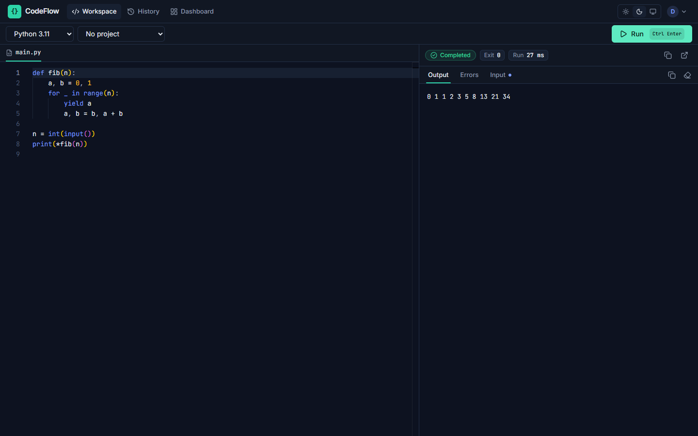
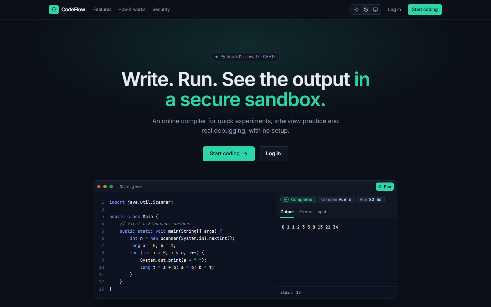
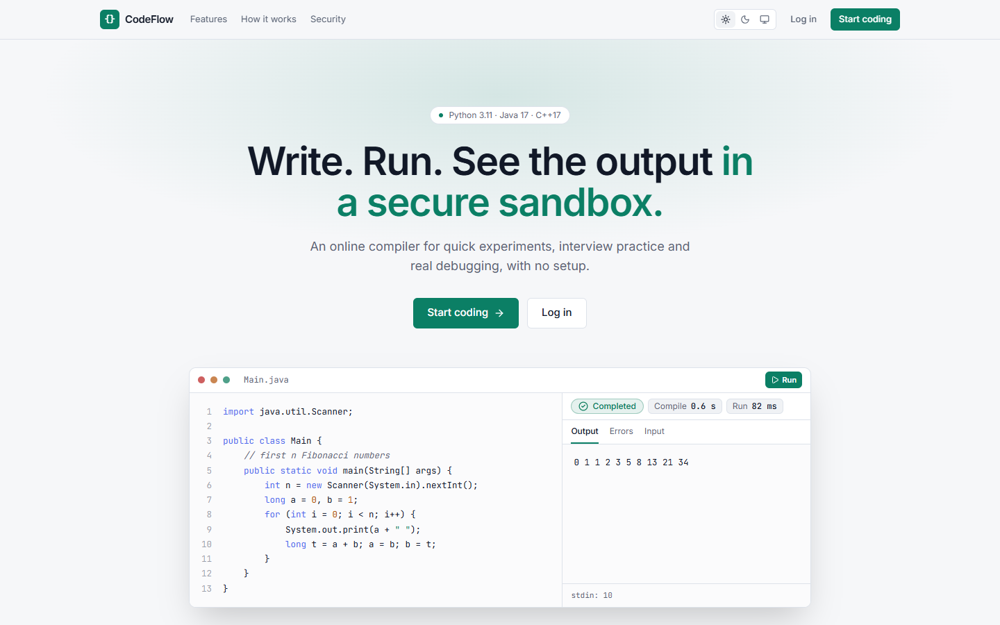
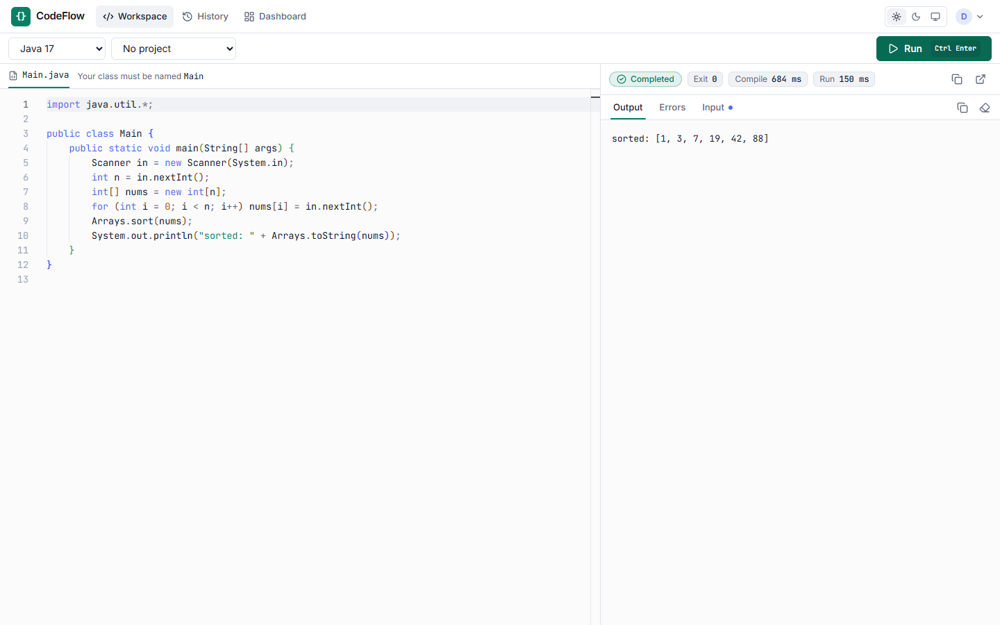
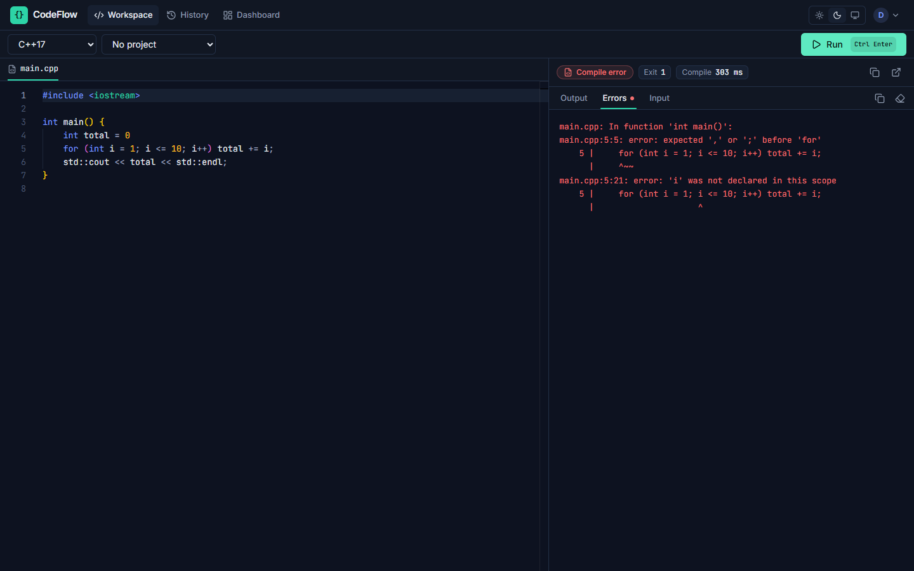
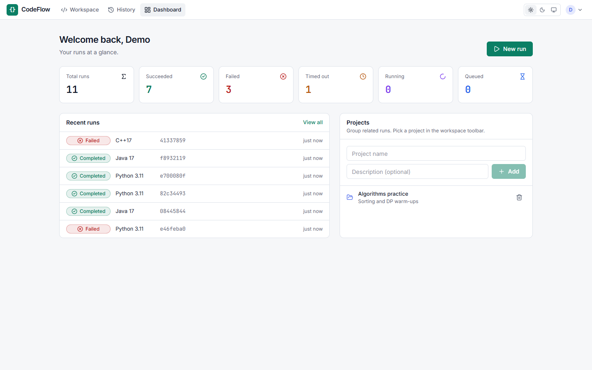
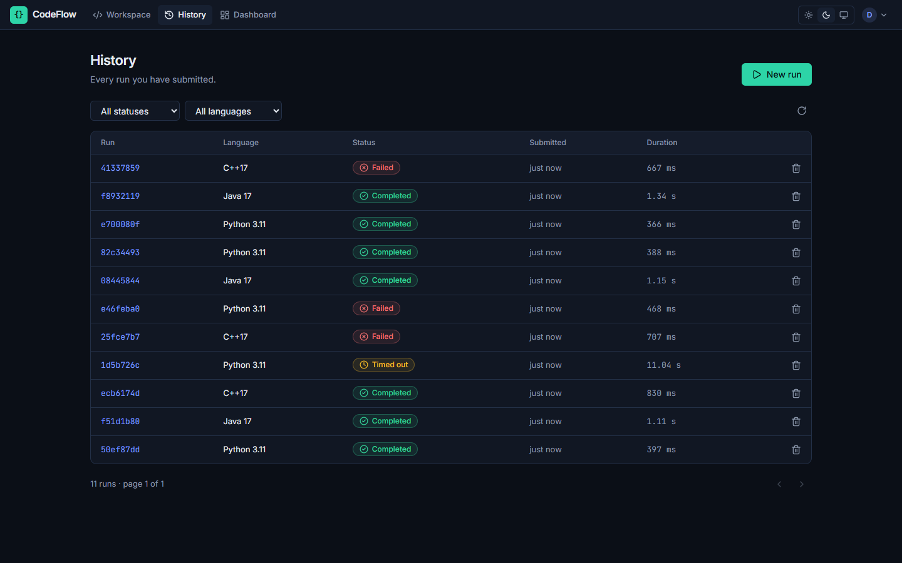
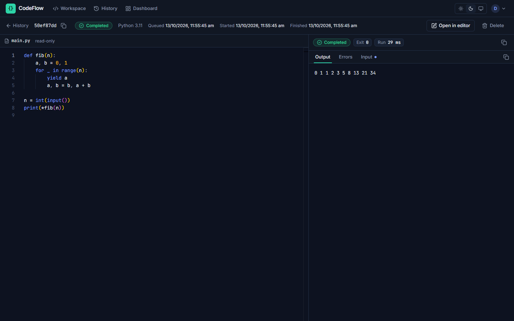
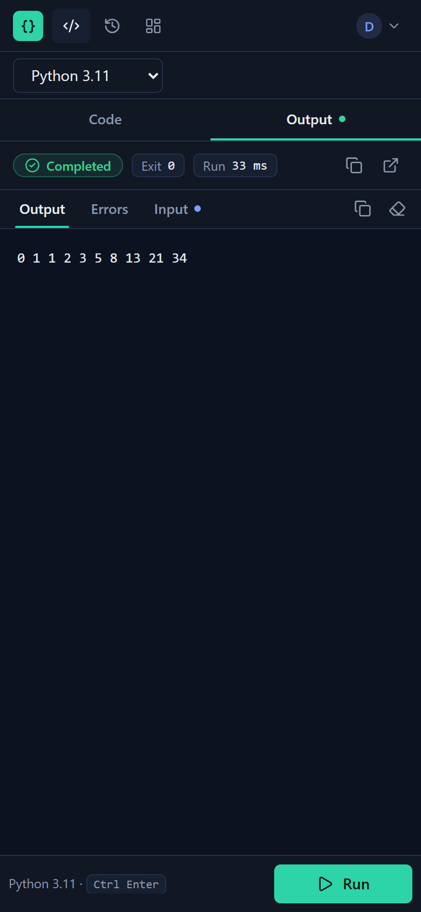

# CodeFlow

CodeFlow is an online compiler. Users sign up, write Python, Java or C++ in the browser, attach optional stdin, and get the output back. Every program runs in its own throwaway container, sandboxed and resource-limited.



## Features

- **IDE-style workspace.** A Monaco editor and the output sit side by side with a draggable divider, with separate Output, Errors and Input (stdin) tabs. Run with the button or **Ctrl/⌘ + Enter**; drafts are kept per language.
- **Honest timings.** Compile time (Java and C++) and run time (just your program) are measured separately inside the sandbox.
- **Clear outcomes.** Completed, failed, compile error, timed out, memory limit and truncated output each have their own state.
- **Run history.** Filter by status, language or project, reopen any run read-only, or load it back into the editor.
- **Projects and a dashboard** to group runs and see totals at a glance.
- **Light, dark and system themes**, a layout that adapts to phones, and WCAG AA contrast.
- **Secure by default.** No network, a read-only filesystem, an unprivileged user, and CPU, memory, process and time limits. Every run is a fresh container.

## Screenshots

| Dark | Light |
|---|---|
|  |  |
|  |  |
|  |  |
|  |  |

<p align="center">
  
</p>

## Architecture

```
browser ──► nginx (frontend) ──/api──► FastAPI ──► Postgres
                                          │
                                          └─LPUSH─► Redis ──BLMOVE──► worker(s) ──► docker-socket-proxy ──► sandbox container
```

| Component | What it does |
|---|---|
| `frontend/` | React + Vite SPA. In Docker it's served by nginx, which also proxies `/api`, so the browser only ever talks to one origin. |
| `backend/` | FastAPI app for auth (JWT access + refresh tokens), projects, jobs and stats. Alembic owns the schema. |
| `worker/` | Pulls job IDs from Redis, atomically claims them in Postgres, runs them in the sandbox and records the results. It's independent of the backend's code. |
| `docker-socket-proxy` | The only service that can reach the Docker socket. It exposes only the container and image endpoints. |

## Quick start (Docker)

Prerequisites: Docker with Compose v2.

```bash
cp .env.example .env
# edit .env: set SECRET_KEY (python -c "import secrets; print(secrets.token_hex(32))") and POSTGRES_PASSWORD
docker compose up --build
```

- App: http://localhost:5173
- API docs: http://localhost:5173/api/v1/docs
- Direct API access: http://localhost:8000. If that port or 5173 is taken, set `API_PORT` / `WEB_PORT` in `.env`.
- On its first start the worker pulls the sandbox images (`python:3.11-slim`, `eclipse-temurin:17-jdk`, `gcc:13`, about 2 GB). Python is usable straight away; Java and C++ become available once their images have downloaded.

Make a user an admin (admins can list users and change roles):

```bash
docker compose exec api python -m app.cli promote you@example.com
```

## Local development without Docker for the app

Run Postgres and Redis from compose (`docker compose up db redis`), then:

```bash
python -m venv .venv && source .venv/bin/activate      # Windows: .venv\Scripts\activate
pip install -e "backend[dev]" -e "worker[dev]"

cd backend && alembic upgrade head && uvicorn app.main:app --reload   # API on :8000
cd worker && python -m worker.main                                     # needs a local Docker daemon
cd frontend && npm ci && npm run dev                                   # UI on :5173, proxies /api to :8000
```

## Tests

```bash
cd backend && pytest                 # API, auth, validation, migrations (SQLite, no services needed)
cd worker && pytest                  # job lifecycle, queue recovery, sandbox options; real-Docker tests run when a daemon is available
cd frontend && npm test              # auth/session handling, token refresh, helpers
```

## Execution sandbox

Each job runs in a fresh container that is removed afterwards:

- no network (`network_mode=none`)
- read-only root filesystem, plus a 64 MB `tmpfs` at `/tmp` as the only writable space
- runs as `nobody` (uid 65534), with all capabilities dropped and `no-new-privileges` set
- memory capped with swap disabled (128 MB for Python, 256 MB for Java and C++), 1 CPU, a pid limit (fork bombs fail), and an open-file limit
- a wall-clock timeout (10 s by default) after which the container is killed. Output is capped at 64 KB per stream.
- code and stdin go in through environment variables, so nothing is bind-mounted from the worker

Each result reports **compile time** (Java and C++) and **run time** (just your program) separately, measured inside the container. Starting a fresh container adds about 0.2 s on top of both. That is the price of one throwaway container per job, which keeps every run isolated from every other.

Limits are set per language with `*_IMAGE` and `*_MEMORY_LIMIT`, plus `EXECUTOR_CPUS` and `EXECUTION_TIMEOUT_SECONDS`. `.env.example` lists them all.

### Reliability

- The API marks a job `failed` and returns 503 if it can't reach Redis, so jobs are never silently stuck in `queued`.
- Workers move a job into a per-worker processing list (`BLMOVE`) and acknowledge it only after the result is saved. If a worker stops heartbeating, another worker requeues its in-flight jobs.
- Claiming a job is a conditional `UPDATE ... WHERE status='queued'`, so a job enqueued twice still runs only once.
- Jobs stuck in `running` well past any possible deadline are marked failed.
- `WORKER_CONCURRENCY` sets how many jobs each worker runs in parallel. You can also scale out with `docker compose up --scale worker=3`.

## Security notes and known limits

- **The Docker socket proxy narrows the attack surface but does not remove it.** Anything that can create containers can, in principle, create privileged ones. For untrusted multi-tenant use, run the sandboxes under gVisor (`runsc`) or Kata, or on a dedicated host or VM with rootless Docker.
- Tokens are stored in `localStorage`. **Log out** revokes every token for that user on the server (`POST /auth/logout`). Access tokens last 30 minutes and refresh tokens 7 days.
- Rate limits are per IP: 5 registrations/min, 10 logins/min, 20 job submissions/min. Each user can also have at most `MAX_ACTIVE_JOBS_PER_USER` jobs queued or running at once.
- Job status updates are polled with backoff (500 ms rising to 5 s); there is no push channel.
